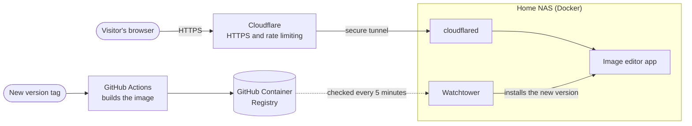

  

<h1 align="center">Image Editor</h1>

  A simple web-based image editor for removing backgrounds and making quick edits, all in your browser. 
  Background removal keeps full resolution, and the app is self-hosted on a home NAS.

  
  

  <b><a href="https://image-editor.shannen-lee.com">Try it out</a></b> · <b><a href="docs/setup.md">Run your own</a></b>

## Features

### Remove backgrounds
Remove the background from a photo with one click, at its full original resolution.

### Replace the background
Swap the background for transparent, white, black, or any colour you pick.

### Crop and resize
Crop freely or with aspect ratio presets, and set an exact width and height.

### Rotate and flip
Turn images in quarter turns or fine-tune the angle, and flip them horizontally or vertically.

### Work on multiple images
Upload, drag in or paste several images and switch between them. Each image remembers its own edits.

### Undo and redo
Step back and forward through your edits with the buttons or Ctrl/⌘+Z and Ctrl/⌘+Shift+Z.

### Download
Download the current image, or all images together as a ZIP, as PNG, JPEG or WebP with adjustable quality.

### Light and dark mode
Follows your system setting, or switch it yourself. Works on desktop and mobile.

## How it works

- **Full-resolution cut-outs from a small upload.** Photos larger than 2048 px are scaled down in the browser before upload. The server runs the [u2netp](https://github.com/danielgatis/rembg) model on that copy and returns only a greyscale mask, and the browser applies the mask to the original photo. Uploads stay small and fast, but the result keeps every pixel of the original.
- **Photos stay the right way up.** The server applies each photo's EXIF orientation before finding the subject, so the mask lines up with the upright photo the browser shows.
- **Built for a small server.** Each visitor is limited to 10 removals a minute, and at most two removals run at once. Extra requests get a "busy" message instead of overloading the machine.
- **Private by default.** Images are processed in memory and never stored. The page loads nothing from other sites, and a strict Content Security Policy enforces that.
- **Editing happens in the browser.** Cropping, rotating, resizing and exporting use [Cropper.js](https://github.com/fengyuanchen/cropperjs) and the HTML canvas, so only background removal needs the server.

## How it's hosted

The live site runs in Docker on my home NAS:

- A **Cloudflare Tunnel** publishes the app without opening any ports on my home network.
- Pushing a version tag makes **GitHub Actions** build the image for Intel and ARM and publish it to the GitHub Container Registry.
- **Watchtower** on the NAS notices the new image and restarts the app with it.

## Built with

- **Backend:** Python, Flask, [rembg](https://github.com/danielgatis/rembg) with the u2netp model on onnxruntime, Pillow, gunicorn
- **Frontend:** HTML, CSS and JavaScript, [Cropper.js](https://github.com/fengyuanchen/cropperjs), [JSZip](https://stuk.github.io/jszip/)
- **Hosting:** Docker, GitHub Actions, GitHub Container Registry, Cloudflare Tunnel, Watchtower

## Photo credits

The example images in the screenshots are from [Unsplash](https://unsplash.com):

- Photo by Insung Yoon on Unsplash
- Photo by Andy Hermawan on Unsplash
- Photo by JK Sloan on Unsplash
